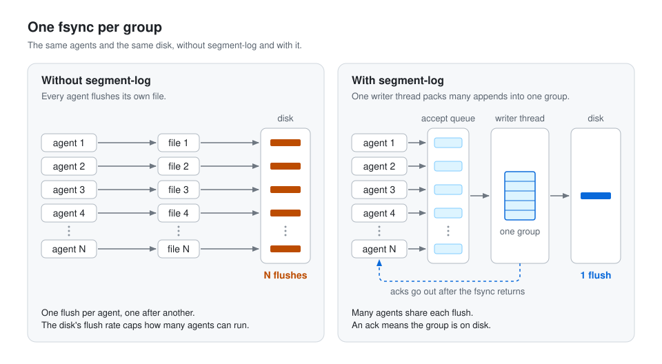

# segment-log

An embedded, append-only event log in Rust, for short-lived processes that need a durable history.

> **Status: pre-release. Milestones M0–M6 have passed.**
> `segment-log-core` appends, rolls, seals and reads logs, and recovers them after a crash. `segment-log-server` serves a log over a Unix socket or vsock; it passed milestone M6, and M7 validates it on the guest deployment. Some decision records are still proposed. The byte layout is format version 1 since M5 ([ADR 0052](docs/decisions/0052-freeze-format-version-1.md)); until the first production release, a format change increments the version and keeps no reader for older ones ([ADR 0053](docs/decisions/0053-format-changes-need-no-older-reader-before-production.md)). The API can change. Do not depend on this yet. See the [milestones](docs/prd.md#milestones) for the plan.

- Many callers append to many streams in one directory.
- One writer thread packs their appends into groups. One `fsync` makes a group durable, and only then does the caller get an acknowledgment.
- Each stream has revisions and checks the caller's expected revision. An idempotency key makes retries safe after a crash.
- When the work ends, the log seals. The sealed segment files are the history.

A Rust program links the library. Other languages reach it through `segment-log-server`, which runs the same library behind a Unix socket or vsock.

## Documents

- [Product requirements](docs/prd.md)
- [Architecture overview](docs/architecture/overview.md)
- [Byte layout](docs/architecture/format.md) · [API sketch](docs/architecture/api.md) · [Wire protocol](docs/architecture/protocol.md) · [Testing](docs/architecture/testing.md) · [Prior art](docs/architecture/prior-art.md)
- [Volume requirements](docs/architecture/volume-requirements.md): what the storage under the log must guarantee, and how to test it
- [Implement a behavior with acceptance tests](docs/acceptance-tests.md)
- [Glossary](docs/glossary.md)
- [Decisions](docs/decisions/README.md)

## Crates

| Crate                | Purpose                                                                                        |
| -------------------- | ---------------------------------------------------------------------------------------------- |
| `segment-log-core`   | The library.                                                                                   |
| `segment-log-server` | A Unix socket and vsock server for callers in other languages. Passed M6; validated on the guest deployment in M7. |

## License

Apache-2.0. See [LICENSE](LICENSE).
