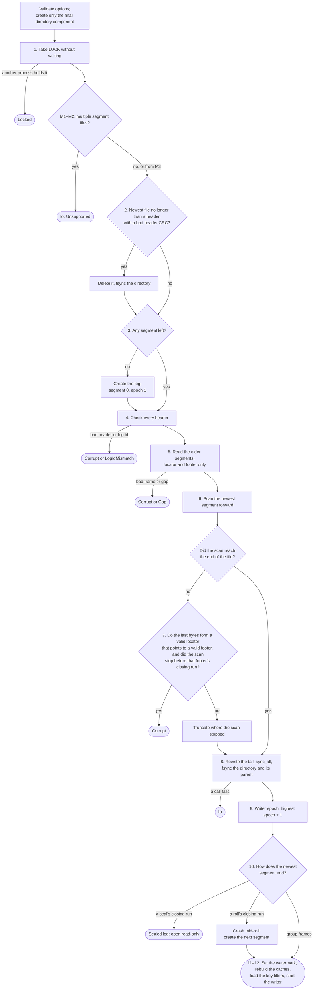

# Architecture overview

This document describes how the segment log works. The [PRD](../prd.md) says what it must do and why. [format.md](format.md) gives the bytes, [api.md](api.md) the interface, and [testing.md](testing.md) the proof. The [decisions](../decisions/README.md) give the reasons. Terms are as defined in the [glossary](../glossary.md).

## Placement

The target workload: tens of thousands of agents that run at the same time on microVMs. Each microVM has one segment log. Many agents in that microVM append to it, so one `fsync` can cover a group of their appends. When the burst ends, the log seals and the process exits.

A segment log for each agent, with each agent calling `fsync`, is the shape this design rejects. Group commit is how the log spreads the cost of flushes. A measurement still has to show whether the disk, rather than the language or the guest, limits the agent count. It also has to show that this placement makes that count possible.

The sealed segments must be on a volume that outlives the guest. When the microVM is destroyed, a file on an ephemeral disk is lost. Recovery never needs the old process to still be there.

The deployment or runner layer owns volume provisioning, mounting, preservation and post-guest reader handoff ([ADR 0033](../decisions/0033-deployment-owns-volumes-and-reader-handoff.md)). The core operates on the directory supplied to `SegmentLog::open`. Before M6, the deployment must identify the mount paths, reader component and handoff procedure, including access for writable recovery of unsealed crash logs. Those integration choices do not block M1.

Orchestration is above the log. Leases, waiting for events, dashboards and SDKs are a different layer, in another process and possibly another language. The log does not store subscribers. Waiting cursors, their positions, cancellation, timeouts and scheduling also belong above the core ([ADR 0035](../decisions/0035-waiting-cursors-belong-above-the-core.md)). M1 provides `watermark()` and bounded `read()` without a native watermark-wait API. Per-submit `Pending::wait` remains unchanged.

```text
callers (threads, or a socket server in M6)
   │ append(submit)            read(from) / stream_head(id)
   ▼                                   ▲
┌──────────────┐   full → Full    ┌─────────────┐
│ accept queue │──────────────────│  watermark  │◄── moves after fsync succeeds
└──────┬───────┘                  └─────────────┘
       ▼
┌──────────────────────────────────────────────┐
│ writer thread (single)                       │
│  gather submits (linger / byte cap)          │
│  check key, then expected revision           │
│  assign offsets and revisions                │
│  write one frame, fsync once                 │
│  advance watermark, ack each submit          │
└──────┬───────────────────────────────────────┘
       ▼
 dir/ LOCK  00000000000000000000.seg  00000000000000200000.seg (active)
```

## Components

- **Accept queue.** A bounded multi-producer queue. `append` checks size eligibility, then reserves the submit's admission byte charge before accepting it. Impossible size fits give `TooLarge`; unavailable current queue capacity or byte budget gives `Full` at once. The byte reservation remains until the request is answered, including time in a writer group or as a matched retry waiter ([ADR 0025](../decisions/0025-admission-byte-reservations-live-until-the-answer.md)).
- **Writer thread.** The only thread that writes segment files. It owns the tail map and the key map, and it assigns log offsets and revisions. Because one thread does every check, a check is atomic with respect to other appends.
- **Segments.** Append-only files. The active segment takes new frames. Sealed segments never change.
- **Watermark.** An atomic value that readers load. Only the writer stores it.
- **Caches.** The tail map, the key map, the sparse index and, from M4, the key filters that open loads from sealed segments. The log can rebuild each one from the segments.

## Storage contract

The durability invariants hold only if the volume under the log meets the MUST requirements in [volume-requirements.md](volume-requirements.md) ([ADR 0040](../decisions/0040-volumes-meet-testable-minimum-requirements.md)). That document is the only source for them, their pass criteria and how to verify them. They cover flush durability through every layer, atomic sector writes, the filesystem's response to metadata write errors, a local filesystem, one writing kernel, survival of the guest, a declared failure domain, consistent copies, capacity and drift.

The library cannot check them. Each deployment must check them ([PRD open item 3](../prd.md#open-items)). [ADR 0032](../decisions/0032-qualify-deployment-storage-before-m6.md) requires qualification of the actual stack before the M6 guest benchmark and production durability claims. M1 implements and tests the explicit conditional contract; its completion evidence does not certify the eventual guest stack.

## Invariants

These rules hold at every point. Code and tests must not break them. A change to one of them needs a new ADR.

- **I1. Ack after fsync.** No caller gets an ack, and no reader sees a record, before the `fsync` that covers it returns success.
- **I2. The watermark never moves back.** In one process it only grows. A reopen sets it to at least the last watermark of the previous process, if the storage meets its [contract](#storage-contract). It can be higher, because recovery keeps a valid suffix that was never acknowledged.
- **I3. Acknowledged means kept.** If the storage meets its [contract](#storage-contract), recovery keeps every acknowledged record with its log offset and revision.
- **I4. Prefix only.** After recovery, the log is a prefix of the order in which groups were written. It has no hole and no change of order.
- **I5. New records in a submit are all or nothing.** The writer puts all of them in one frame, or writes none. A fully deduplicated retry only confirms existing durable records ([ADR 0024](../decisions/0024-fully-matching-retries-ignore-original-grouping.md)).
- **I6. Durable offsets are never used again.** Offsets from a torn tail can be.
- **I7. Sealed segments never change.** Recovery never truncates them.
- **I8. One writer.** At most one process holds the directory lock and writes.
- **I9. A cache is never the only copy of a fact.** The segment files hold every fact. The log id and every frame's epoch live in the files. The writer derives its own epoch from them, so that value is a cache too.
- **I10. Poisoned stays poisoned.** After an I/O error on the write path, the writer refuses all submits until reopen.

## The write path

1. A caller sends a submit. `append` follows the [admission order](api.md#admission-and-answer-ordering): structural validation, permanent size eligibility, writer state, then current capacity. Repeated keys get `Invalid`. Exceeding the standalone group-body cap or entire admission budget, or charge overflow, gets `TooLarge` before capacity reservation. A size-eligible request reserves its charge before acceptance. Unavailable current queue capacity or byte budget gives `Full` and retains no reservation.
2. The writer takes submits in admission order and classifies each under step 3 while it gathers a group. It stops when linger ends or the next new submit would exceed the group-body cap. The linger runs from the admission of the group's first new submit, so the time that submit spent queued behind the previous flush counts. When the writer first sees that the linger has ended, the group takes only the queued submits that were admitted before that moment, and a later submit starts the next group ([ADR 0046](../decisions/0046-linger-runs-from-the-first-submits-admission.md)). Count one body header and only the new records that will be written. Rejections and fully matched retries contribute no encoded bytes. A new submit that would exceed the current group's cap waits for the next group without reordering. From M4, so does a new submit whose new streams or keys would make the active segment's footer or key index frame pass the frame limit, and the next group rolls before it stages that submit. A group with no new records causes no frame write or flush.
3. For each submit, in order of admission, the writer:
   1. checks the idempotency keys ([ADR 0008](../decisions/0008-idempotency-key-before-expected-revision.md)). A key that identifies a pending or durable record with a different stream or payload rejects the entire submit with `KeyConflict` at its first conflicting record ([ADR 0022](../decisions/0022-reject-conflicting-key-reuse-from-m1.md)). Otherwise, a mix of matching existing records and new or unkeyed records rejects the entire submit with `PartialRetry` ([ADR 0023](../decisions/0023-reject-mixed-reused-and-new-records-from-m1.md)). Neither rejection consumes an offset or revision or poisons the writer. If every record has a key and matches a pending or durable record with the same stream and payload, it is a fully deduplicated retry regardless of original grouping ([ADR 0024](../decisions/0024-fully-matching-retries-ignore-original-grouping.md)). The writer adds no records, skips expected revisions, and returns original positions in request order once all referenced records are durable. Pending matches attach the retry as a waiter for their group.
   2. checks each expected revision against the tail map and the pending changes from earlier submits in this group. A mismatch rejects the whole submit, and the submit uses no offset.
   3. assigns log offsets and revisions, and adds the records to the group and to the pending changes.
4. The writer writes the group as one frame at the end of the active segment, then calls `fsync` once.
5. If the `fsync` succeeds: the writer applies the pending changes to the tail map and the key map, moves the watermark, and acks each new submit and each matched retry waiting for this group. Retry waiters get original positions in request order with `deduplicated: true`. The writer records every answer of the group, then wakes only a few of its callers. Each woken caller wakes a few more before it returns ([ADR 0044](../decisions/0044-woken-callers-relay-group-acks.md)).
6. If a write, `fsync`, or durable-key lookup read, frame validation or key index page validation fails, the writer is poisoned ([ADR 0004](../decisions/0004-io-errors-poison-the-writer.md)). Every unfinished request in the current group, including the lookup request and matched retry waiters, gets `Indeterminate`. This includes a group not yet written. Each request still queued or deferred to the next group, and each later admitted request, gets `Poisoned`. Results already finalized under the [answer-ordering rules](api.md#admission-and-answer-ordering) stay fixed. No later write or flush is attempted on the failed handle.
7. From M3, if the active segment is at or over the roll size, the writer [rolls](#roll) before the next group's first new submit joins that group. A group with no new records does not roll, so step 2 still holds for it. From M4, the writer also rolls before a group whose new streams would make the segment's footer pass the frame limit ([ADR 0017](../decisions/0017-footer-locator-offset-and-size.md)), or whose keys would make its key index frame pass it ([ADR 0048](../decisions/0048-sealed-segments-carry-a-key-filter-and-index.md)).

A fully matching retry in step 3.1 may select subsets, reorder records, combine original submits, or mix pending and durable matches. All-durable matches need no new `fsync`. Pending matches wait for their existing group's flush and watermark publication. Normal admission limits still apply. Retry success confirms durability, not that the records originally committed atomically together. New writes retain their all-or-nothing submit guarantee.

From M4, step 3.1 looks for an existing key in this order ([ADR 0048](../decisions/0048-sealed-segments-carry-a-key-filter-and-index.md)): the keys staged by the current group, then the active segment's key map, then each sealed segment's [key filter](format.md#key-filter-frame-m4), from the newest segment back. For each "maybe", the writer reads the key index page that can hold the key's [hash](format.md#key-hash-m4), then reads and validates each group frame that an entry with that hash names, and compares the key bytes first. A different key there is a false hit, and the writer tries the next entry with that hash, then older segments. A false hit is never a match, never a `KeyConflict` and never a lookup failure. Through M3, the key map holds every retained key.

Each accepted request holds its admission byte reservation through processing and retry waiting. Every answer path releases it, including rejection, success and poison. Queue insertion failure and writer shutdown must not leak reservations. A dropped result handle does not release a request that is still being processed. The charge includes retained allocation capacities and explicit bookkeeping and result allowances under [ADR 0026](../decisions/0026-admission-charges-retained-allocations.md). The [formula](api.md#admission-charge) is separate from encoded group size and does not bound total process memory. The default is an accounting ceiling without a budget-sized preallocation ([ADR 0027](../decisions/0027-default-admission-budget-is-an-accounting-ceiling.md)). Requests that cannot fit the entire budget get `TooLarge` under ADR 0028.

## Commit protocol

The protocol is the indeterminate suffix ([ADR 0003](../decisions/0003-recovery-keeps-the-checksum-valid-prefix.md)). The contract is the one a disk already gives:

- An ack means the group survived, if the storage meets its [contract](#storage-contract).
- An unknown outcome means the group might have survived. A terminal rejection confirms that the request appended nothing.
- Recovery cannot tell if the previous process saw `fsync` return.
- Recovery removes a torn tail. It keeps the contiguous valid prefix, and that prefix sets the watermark. The log makes the kept prefix durable before it publishes the watermark ([ADR 0015](../decisions/0015-open-makes-the-recovered-tail-durable.md)).
- A fully keyed retry with the same stream ids and payloads finds surviving records and returns their original log offsets and revisions. [Mixed and unkeyed submissions](api.md#retry-after-an-unknown-outcome) have narrower retry guarantees.


A stricter rule, "ignore a CRC-valid suffix after the last acknowledged group", was rejected. One barrier cannot record its own completion, so that rule needs a second `fsync` for each group. That doubles the flush cost that this design exists to spread. It still cannot make "no ack" mean "absent", because the process can die after the `fsync` and before it sends the ack. Also, if recovery drops a valid suffix, it drops the only copy of its idempotency keys. Then a retry looks new, and its side effect can run twice.

**`kill -9`** leaves the bytes that were already written in the page cache. The kernel writes them later. It loses the accept queue and any group that was not yet written. **Power loss** can also drop or tear bytes that were written but not flushed. A **failed `fsync`** can leave bytes that a read returns but that are not on the device. Recovery can read all three kinds of bytes, so it makes the tail durable before it trusts it ([ADR 0015](../decisions/0015-open-makes-the-recovered-tail-durable.md)). The crash tests model all three ([testing.md](testing.md)).

## Open and recovery

The flowchart shows the decisions in the steps below. The steps are the rule. If the two disagree, the steps win, and the flowchart must be fixed in the same change.

The flowchart shows the cumulative algorithm. The [API's option and layout checks](api.md#opening-a-directory) run before recovery mutations. M1 and M2 handle one segment without roll. M3 adds the older-segment scans and roll recovery in the steps below. M4 adds the closing-run branches.



1. If the directory does not exist, create only its final component under an already durable parent. Missing ancestors fail with `Io`; do not create them recursively. Take the OS lock on `LOCK` without waiting. If another process holds it, fail with `Locked`. Before recovery mutations, apply the milestone layout check in [api.md](api.md#opening-a-directory).
2. List the segment files and sort them by base offset. If the newest file is no longer than a segment header and its header CRC does not match, delete it and `fsync` the directory. A crash while creating the segment left it, and it holds no record, because the writer appends frames to a new segment only after its header and its directory entry are durable. Any other bad header is an error, never a deletion.
3. If no segment is left, create the log. Take the `log_id` from the storage trait's random bytes. Write segment `00000000000000000000.seg` with its header and epoch 1, `sync_data` it, and `fsync` the directory.
4. Check every header against the [rules for readers](format.md#rules-for-readers). A bad header fails with `Corrupt`. A different log id fails with `LogIdMismatch`.
5. From M3, read every segment except the newest. Each one is sealed. From M4, its successor proves that its real locator is its last frame. In M3, scan all of its frames to rebuild the caches. From M4, read only its locator and its footer. Any frame that is not valid fails with `Corrupt`. Recovery never truncates a sealed segment. Each sealed segment's next unused offset must equal the next segment's base offset. A gap fails with `Gap`.
6. Scan the newest segment forward from the header under the [rules for readers](format.md#rules-for-readers). From M4, the newest segment is sealed only if the scan reaches the end of the file through a complete closing run, a roll's or a seal's. The last bytes alone never decide this, because the tail of a record's payload can look like a locator.
7. If the scan stopped before the end of the file, apply the following check from M4 before changing the file. Check the last 40 bytes and the footer frame they name on their own: length, CRC, kind, reserved fields and body layout, without the offset and epoch continuity of the scan, which stopped before them. If they form a valid locator that points to a valid footer frame, and the scan stopped before that footer's closing run starts, fail with `Corrupt`, because this is a sealed segment with a bad group frame and recovery never truncates one. The run starts at the footer's `key_filter_position`, or at the footer when that is `0`. Otherwise, or before M4, truncate where the scan stopped. A scan that stopped at the start of the run, because the run is not complete and valid, means that a power loss kept the footer and locator pages and dropped another page of the run, such as a key frame page or the seal frame. Closing frames that truncation drops were written before an `fsync` that never returned, so no ack depends on them. Frame CRCs start with the log id ([ADR 0049](../decisions/0049-frame-crcs-cover-the-log-id.md)), so a closing run inside a torn group's payload fails its CRC, and open truncates that group. Only a caller that can read the segment files could forge one.
8. Make the end of the newest segment durable ([ADR 0015](../decisions/0015-open-makes-the-recovered-tail-durable.md)). Write back, at the same position and with the same bytes, the trailing closing frames if the segment ends with any. Otherwise, write back the last group frame. If it has neither, write back the header. Then call `sync_all` on the segment, and `fsync` the log directory and its parent. If a call fails, open fails with `Io`.
9. Set the writer epoch to one more than the highest epoch in any segment header or kept frame ([ADR 0018](../decisions/0018-writer-epoch-from-the-segments.md), [ADR 0047](../decisions/0047-writer-epoch-from-every-segment.md)). If step 3 created the log, the writer epoch is 1, as in its header.
10. Decide the state from the end of the newest segment:
    - If step 6 found it sealed by a seal's run, the log is sealed. Open read-only.
    - From M4, if step 6 found it sealed by a roll's run, the crash came after the roll's `fsync` and before the next segment existed. Create the next segment, as in roll steps 2–4.
    - Otherwise it is the active segment.
11. Set the watermark to the offset after the last kept record. Rebuild the tail map and the key map from the kept frames. From M4, the tail map comes from the footers and the scan of the newest segment, and the key map holds only the active segment's keys. Then read the key filter frame that each sealed segment's footer names, including a segment that step 10 found sealed by a roll's run, and keep each filter in memory ([ADR 0048](../decisions/0048-sealed-segments-carry-a-key-filter-and-index.md)). A key filter that is not valid fails with `Corrupt`. Open reads the key filters before step 8 changes any file, so that a bad key filter fails open and leaves every file as it was. A sealed log reads no key filter, because it never checks a key.
12. Start the writer thread.

Through M3, recovery rebuilds keys by scanning retained segment records. From M4, it scans only the newest segment, and the writer finds older keys through each sealed segment's key filter and key index ([ADR 0048](../decisions/0048-sealed-segments-carry-a-key-filter-and-index.md)). A key remains valid after roll and reopen while its segment is retained ([ADR 0031](../decisions/0031-keys-live-with-retained-segments.md)). Footers alone do not contain the keys. Key-cache memory follows rule 5 of ADR 0048 and has no fixed upper limit.

Open reads all of the newest segment. In the open-time target's conditions, that is the small active segment. From M4, open also reads the key filters, about 2 bytes for each key in the sealed segments, so open time grows with keyed history. The owner accepted this in ADR 0048. A sealed log's final segment can be as large as the roll size.

There is no clean-shutdown marker. Recovery always scans the active segment, and that costs little because the segment is small. The seal frame marks a sealed log ([ADR 0011](../decisions/0011-sealed-footer-and-no-shutdown-marker.md)).

## Roll

A roll happens only between groups, so no submit crosses a roll.

1. From M4: write the key filter frame, the key index frame, the footer frame and the locator frame at the end of the active segment, and `fsync` it. The segment is now sealed. The writer builds the key frames from the active segment's key map.
2. Create the new segment file, named by the next log offset. Write its header and `sync_data` the file, as open does when it creates the log.
3. `fsync` the directory, so that the new directory entry is durable.
4. Make the new file the active segment. From M4, keep the sealed segment's key filter in memory and start an empty key map.

Before M4, step 1 does nothing. Every segment except the newest counts as sealed.

The writer rolls when the first new submit of a group has passed its checks, before it stages any record of that group. A submit that appends nothing never starts a roll. A segment with no record does not roll, because the new segment would take its name. A roll size that an empty segment has already reached therefore rolls after every group that wrote a frame.

If any step of a roll fails, the writer is poisoned ([ADR 0004](../decisions/0004-io-errors-poison-the-writer.md)). No group is in flight during a roll. The submit that started the roll and every queued submit get `Poisoned`, because the writer wrote none of their records. The writer never appends to a segment after writing that segment's first closing frame.

## Seal

Seal ships in M4, together with the footer and the locator. A seal frame is never written without a locator after it, so recovery never meets a sealed segment that it cannot recognize.

1. Stop admission. New submits get `Sealed`.
2. Commit the submits that are already in the queue, as usual. If a write or an `fsync` fails, the writer is poisoned, `seal` returns `Poisoned`, and step 3 does not run.
3. Write the footer, the seal frame and the locator, with no key frames ([ADR 0048](../decisions/0048-sealed-segments-carry-a-key-filter-and-index.md)). `fsync`. If a write or the `fsync` fails, the writer is poisoned and `seal` returns `Poisoned`.
4. Stop the writer thread and release the lock. The handle keeps the segment files open, so `read`, `watermark` and `stream_head` keep working until it is dropped. The process can exit.

## Read-only reader

A reader after the guest is gone uses `LogReader` ([ADR 0016](../decisions/0016-read-only-reader-without-a-lock.md)). It opens only a sealed log. It runs the checks and scans of open steps 4–7 without deleting, truncating, syncing or locking anything. It reads no key filter, because a reader never checks a key. Where open would truncate, the log is not sealed. Every record in a sealed log was covered by an `fsync` that returned before the seal frame was written, so the reader never shows a record that I1 forbids. It works on a read-only volume and with many readers at once. An unsealed log fails with `NotSealed`. To read one, open it with `SegmentLog::open` on a writable volume, which recovers it, and then `seal` it.

## Retention

M1–M6 retain complete valid history without segment-level retention ([ADR 0037](../decisions/0037-retain-complete-logs-through-current-milestones.md)). The core does not delete valid history segments even when a later footer covers their streams. Deployment owns whole-log archival and expiry under its lifecycle policy. Storage can grow until that policy archives or expires a complete log.

Recovery still keeps the valid prefix and removes invalid, uncommitted tails or incomplete new segments under its existing rules. That cleanup is separate from retention. A future bounded-history feature needs durable revision checkpoints, key-expiry rules, deleted-offset reads and crash-safe deletion behavior before it can remove valid segments.

## Language boundary

The library is Rust. It has no async runtime, SQL or protobuf on the write path. A caller in another language reaches it over a Unix socket or vsock through `segment-log-server` (M6). There is no in-process C ABI. A separate process can be sealed and killed without the orchestrator. A guest can be just the Rust server, with no other runtime in it. See [ADR 0001](../decisions/0001-rust-library-first-socket-boundary-later.md).

M6 implements Unix socket first, followed by vsock with the same protocol ([ADR 0034](../decisions/0034-m6-builds-unix-socket-before-vsock.md)). Both transports remain required for M6. This sequence establishes a local Go-client protocol path before guest transport integration. Actual caller placement still determines the deployed transport, and the wire format remains a separate M6 decision. M1 remains library-only.

## What a library build must still show

These are targets that nobody has measured yet:

- the build is small enough for a microVM,
- open time after M4 meets its target, including the key filters that [ADR 0048](../decisions/0048-sealed-segments-carry-a-key-filter-and-index.md) adds to it,
- a snapshot's dirty set is only the written segment pages plus the caches, the accept queue and the key map,
- startup and seal time fit the [footprint targets](../prd.md#footprint-and-performance-targets).
