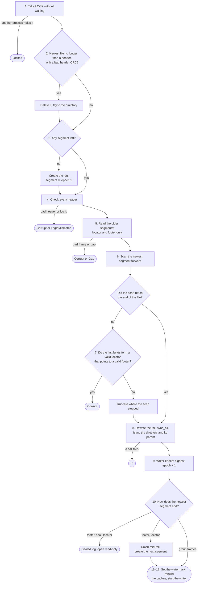

# Architecture overview

This document describes how the segment log works. The [PRD](../prd.md) says what it must do and why. [format.md](format.md) gives the bytes, [api.md](api.md) the interface, and [testing.md](testing.md) the proof. The [decisions](../decisions/README.md) give the reasons. Terms are as defined in the [glossary](../glossary.md).

## Placement

The target workload: tens of thousands of agents that run at the same time on microVMs. Each microVM has one segment log. Many agents in that microVM append to it, so one `fsync` can cover a group of their appends. When the burst ends, the log seals and the process exits.

A segment log for each agent, with each agent calling `fsync`, is the shape this design rejects. Group commit is how the log spreads the cost of flushes. A measurement still has to show whether the disk, rather than the language or the guest, limits the agent count. It also has to show that this placement makes that count possible.

The sealed segments must be on a volume that outlives the guest. When the microVM is destroyed, a file on an ephemeral disk is lost. Recovery never needs the old process to still be there.

Orchestration is above the log. Leases, waiting for events, dashboards and SDKs are a different layer, in another process and possibly another language. The log does not store subscribers.

```text
callers (threads, or a socket server in M6)
   │ append(submit)            read(from) / stream_head(id)
   ▼                                   ▲
┌──────────────┐   full → Full    ┌─────────────┐
│ accept queue │──────────────────│  watermark  │◄── moves after fsync succeeds
└──────┬───────┘                  └─────────────┘
       ▼
┌──────────────────────────────────────────────┐
│ writer thread (single)                       │
│  gather submits (linger / byte cap)          │
│  check key, then expected revision           │
│  assign offsets and revisions                │
│  write one frame, fsync once                 │
│  advance watermark, ack each submit          │
└──────┬───────────────────────────────────────┘
       ▼
 dir/ LOCK  00000000000000000000.seg  00000000000000200000.seg (active)
```

## Components

- **Accept queue.** A bounded multi-producer queue. `append` puts the submit in it, or returns `Full` at once.
- **Writer thread.** The only thread that writes segment files. It owns the tail map and the key map, and it assigns log offsets and revisions. Because one thread does every check, a check is atomic with respect to other appends.
- **Segments.** Append-only files. The active segment takes new frames. Sealed segments never change.
- **Watermark.** An atomic value that readers load. Only the writer stores it.
- **Caches.** The tail map, the key map and the sparse index. The log can rebuild each one from the segments.

## Storage contract

The durability invariants hold only if the storage under the log meets this contract. The library cannot check any of it. Each deployment must check it ([PRD open item 3](../prd.md#open-items)).

- The device honors the flush. When `fsync` returns success, the bytes survive a power loss ([ADR 0005](../decisions/0005-flush-calls-and-platforms.md)).
- The device writes each sector atomically. After a power loss, a sector holds either its old or its new contents. Open relies on this when it rewrites bytes that are already durable ([ADR 0015](../decisions/0015-open-makes-the-recovered-tail-durable.md)).
- The filesystem stops accepting writes after a metadata write error, so a failed directory `fsync` is never followed by a successful one that wrote nothing ([ADR 0015](../decisions/0015-open-makes-the-recovered-tail-durable.md)).

## Invariants

These rules hold at every point. Code and tests must not break them. A change to one of them needs a new ADR.

- **I1. Ack after fsync.** No caller gets an ack, and no reader sees a record, before the `fsync` that covers it returns success.
- **I2. The watermark never moves back.** In one process it only grows. A reopen sets it to at least the last watermark of the previous process, if the storage meets its [contract](#storage-contract). It can be higher, because recovery keeps a valid suffix that was never acknowledged.
- **I3. Acknowledged means kept.** If the storage meets its [contract](#storage-contract), recovery keeps every acknowledged record with its log offset and revision.
- **I4. Prefix only.** After recovery, the log is a prefix of the order in which groups were written. It has no hole and no change of order.
- **I5. A submit is all or nothing.** It is in one frame, or in none.
- **I6. Durable offsets are never used again.** Offsets from a torn tail can be.
- **I7. Sealed segments never change.** Recovery never truncates them.
- **I8. One writer.** At most one process holds the directory lock and writes.
- **I9. A cache is never the only copy of a fact.** The segment files hold every fact. The log id and every frame's epoch live in the files. The writer derives its own epoch from them, so that value is a cache too.
- **I10. Poisoned stays poisoned.** After an I/O error on the write path, the writer refuses all submits until reopen.

## The write path

1. A caller sends a submit. If the accept queue is full, the caller gets `Full`.
2. The writer takes the first submit from the queue. Then it takes more, until the linger time ends or the next submit would make the group bigger than the byte cap. A submit bigger than the byte cap gets `TooLarge` at admission.
3. For each submit, in order of admission, the writer:
   1. checks the idempotency keys ([ADR 0008](../decisions/0008-idempotency-key-before-expected-revision.md)). If every key matches a durable record with the same bytes, the submit is a retry. The writer answers it with the original offsets and revisions, and it does not add it to the group.
   2. checks each expected revision against the tail map and the pending changes from earlier submits in this group. A mismatch rejects the whole submit, and the submit uses no offset.
   3. assigns log offsets and revisions, and adds the records to the group and to the pending changes.
4. The writer writes the group as one frame at the end of the active segment, then calls `fsync` once.
5. If the `fsync` succeeds: the writer applies the pending changes to the tail map and the key map, moves the watermark, and acks each submit.
6. If any write or `fsync` fails: the writer is poisoned ([ADR 0004](../decisions/0004-io-errors-poison-the-writer.md)). Each submit in the group gets `Indeterminate`. Each submit still in the queue, and each later one, gets `Poisoned`.
7. If the active segment is at or over the roll size, the writer rolls before it starts the next group. From M4, the writer also rolls before a group whose new streams would make the segment's footer pass the frame limit ([ADR 0017](../decisions/0017-footer-locator-offset-and-size.md)).

A submit that is answered as a retry (step 3.1) refers only to records that are already durable. So its answer does not wait for the `fsync`. A retry of a record that is still pending in this group or in another group that is not yet durable does not match in step 3.1. It gets the normal revision check, which usually fails. This is [PRD open item 8](../prd.md#open-items).

## Commit protocol

The protocol is the indeterminate suffix ([ADR 0003](../decisions/0003-recovery-keeps-the-checksum-valid-prefix.md)). The contract is the one a disk already gives:

- An ack means the group survived, if the storage meets its [contract](#storage-contract).
- No ack means the group might have survived.
- Recovery cannot tell if the previous process saw `fsync` return.
- Recovery removes a torn tail. It keeps the contiguous valid prefix, and that prefix sets the watermark. The log makes the kept prefix durable before it publishes the watermark ([ADR 0015](../decisions/0015-open-makes-the-recovered-tail-durable.md)).
- A retry with the same key and the same bytes finds the survivor and returns its original log offset and revision.


A stricter rule, "ignore a CRC-valid suffix after the last acknowledged group", was rejected. One barrier cannot record its own completion, so that rule needs a second `fsync` for each group. That doubles the flush cost that this design exists to spread. It still cannot make "no ack" mean "absent", because the process can die after the `fsync` and before it sends the ack. Also, if recovery drops a valid suffix, it drops the only copy of its idempotency keys. Then a retry looks new, and its side effect can run twice.

**`kill -9`** leaves the bytes that were already written in the page cache. The kernel writes them later. It loses the accept queue and any group that was not yet written. **Power loss** can also drop or tear bytes that were written but not flushed. A **failed `fsync`** can leave bytes that a read returns but that are not on the device. Recovery can read all three kinds of bytes, so it makes the tail durable before it trusts it ([ADR 0015](../decisions/0015-open-makes-the-recovered-tail-durable.md)). The crash tests model all three ([testing.md](testing.md)).

## Open and recovery

The flowchart shows the decisions in the steps below. The steps are the rule. If the two disagree, the steps win, and the flowchart must be fixed in the same change.



1. If the directory does not exist, create it. Take the OS lock on `LOCK` without waiting. If another process holds it, fail with `Locked`.
2. List the segment files and sort them by base offset. If the newest file is no longer than a segment header and its header CRC does not match, delete it and `fsync` the directory. A crash while creating the segment left it, and it holds no record, because the writer appends frames to a new segment only after its header and its directory entry are durable. Any other bad header is an error, never a deletion.
3. If no segment is left, create the log. Take the `log_id` from the storage trait's random bytes. Write segment `00000000000000000000.seg` with its header and epoch 1, `sync_data` it, and `fsync` the directory.
4. Check every header against the [rules for readers](format.md#rules-for-readers). A bad header fails with `Corrupt`. A different log id fails with `LogIdMismatch`.
5. Read every segment except the newest. Each one is sealed. From M4, its successor proves that its real locator is its last frame. Until M4, scan all of its frames to rebuild the caches. From M4, read only its locator and its footer. Any frame that is not valid fails with `Corrupt`. Recovery never truncates a sealed segment. Each sealed segment's next unused offset must equal the next segment's base offset. A gap fails with `Gap`.
6. Scan the newest segment forward from the header under the [rules for readers](format.md#rules-for-readers). From M4, the newest segment is sealed only if the scan reaches the end of the file through the closing run: a footer, then a seal frame if there is one, then a locator that points to that footer. The last bytes alone never decide this, because the tail of a record's payload can look like a locator.
7. If the scan stopped before the end of the file, look at the file's last bytes. If they form a valid locator that points to a valid footer frame, fail with `Corrupt`, because this is a sealed segment with a bad frame and recovery never truncates one. Otherwise truncate the file where the scan stopped. Closing frames that this drops were written before an `fsync` that never returned, so no ack depends on them.
8. Make the end of the newest segment durable ([ADR 0015](../decisions/0015-open-makes-the-recovered-tail-durable.md)). Write back, at the same position and with the same bytes, the trailing closing frames if the segment ends with any. Otherwise, write back the last group frame. If it has neither, write back the header. Then call `sync_all` on the segment, and `fsync` the log directory and its parent. If a call fails, open fails with `Io`.
9. Set the writer epoch to one more than the highest epoch in the newest segment's header and its kept frames ([ADR 0018](../decisions/0018-writer-epoch-from-the-segments.md)). If step 3 created the log, the writer epoch is 1, as in its header.
10. Decide the state from the end of the newest segment:
    - If step 6 found it sealed and its closing run has a seal frame, the log is sealed. Open read-only.
    - From M4, if step 6 found it sealed and its closing run has no seal frame, the crash came after a roll's footer and before the next segment existed. Create the next segment, as in roll steps 2–4.
    - Otherwise it is the active segment.
11. Set the watermark to the offset after the last kept record. Rebuild the tail map and the key map from the kept frames.
12. Start the writer thread.

Open reads all of the newest segment. In the open-time target's conditions, that is the small active segment. A sealed log's final segment can be as large as the roll size.

There is no clean-shutdown marker. Recovery always scans the active segment, and that costs little because the segment is small. The seal frame marks a sealed log ([ADR 0011](../decisions/0011-sealed-footer-and-no-shutdown-marker.md)).

## Roll

A roll happens only between groups, so no submit crosses a roll.

1. From M4: write the footer frame and the locator frame at the end of the active segment, and `fsync` it. The segment is now sealed.
2. Create the new segment file, named by the next log offset. Write its header and `fsync` the file.
3. `fsync` the directory, so that the new directory entry is durable.
4. Make the new file the active segment.

Before M4, step 1 does nothing. Every segment except the newest counts as sealed.

If any step of a roll fails, the writer is poisoned ([ADR 0004](../decisions/0004-io-errors-poison-the-writer.md)). It never appends to a segment after writing that segment's footer.

## Seal

Seal ships in M4, together with the footer and the locator. A seal frame is never written without a locator after it, so recovery never meets a sealed segment that it cannot recognize.

1. Stop admission. New submits get `Sealed`.
2. Commit the submits that are already in the queue, as usual. If a write or an `fsync` fails, the writer is poisoned, `seal` returns `Poisoned`, and step 3 does not run.
3. Write the footer, the seal frame and the locator. `fsync`. If a write or the `fsync` fails, the writer is poisoned and `seal` returns `Poisoned`.
4. Stop the writer thread and release the lock. The handle keeps the segment files open, so `read`, `watermark` and `stream_head` keep working until it is dropped. The process can exit.

## Read-only reader

A reader after the guest is gone uses `LogReader` ([ADR 0016](../decisions/0016-read-only-reader-without-a-lock.md)). It opens only a sealed log. It runs the checks and scans of open steps 4–7 without deleting, truncating, syncing or locking anything. Where open would truncate, the log is not sealed. Every record in a sealed log was covered by an `fsync` that returned before the seal frame was written, so the reader never shows a record that I1 forbids. It works on a read-only volume and with many readers at once. An unsealed log fails with `NotSealed`. To read one, open it with `SegmentLog::open` on a writable volume, which recovers it, and then `seal` it.

## Retention

Retention is deferred ([PRD open item 11](../prd.md#open-items)). The rule from the source design deletes only whole segments, and only after a later footer covers every stream in them. That rule keeps a stream's revisions from restarting at 0. But a stream that ends never appears in a later footer, so with one stream for each agent run, almost no segment becomes deletable. Deleting a segment would also expire the idempotency keys that lived only in it.

## Language boundary

The library is Rust. It has no async runtime, SQL or protobuf on the write path. A caller in another language reaches it over a Unix socket or vsock through `segment-log-server` (M6). There is no in-process C ABI. A separate process can be sealed and killed without the orchestrator. A guest can be just the Rust server, with no other runtime in it. See [ADR 0001](../decisions/0001-rust-library-first-socket-boundary-later.md).

## What a library build must still show

These are targets that nobody has measured yet:

- the build is small enough for a microVM,
- open time stays proportional to the active segment after M4,
- a snapshot's dirty set is only the written segment pages plus the caches, the accept queue and the key map,
- startup and seal time fit the [footprint targets](../prd.md#footprint-and-performance-targets).
