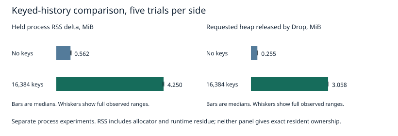

# Mac resident-memory isolation

This diagnostic supports the user's first three Mac follow-ups for issue #20. It isolates resident-memory phases without changing production code, defaults, APIs, format, or dependencies. It does not qualify Linux storage or close the M1 gate.

## Claim and decision rule

The supported claim is that fresh-process recovery permits a bounded comparison of process RSS across independently varied history dimensions before caller submissions or validation buffers exist in that process. It does not expose exact engine-owned resident bytes. Report median and full range across five alternating repetitions. If the gap overlaps run variation, call that comparison inconclusive. Sampled operation peaks are lower bounds; a short operation with no fully contained sample has no observed peak.

The data shape is a history with record count, unique key count, stream count, records per group, and payload bytes. The executable reports a sequence of phase barriers, operation boundaries, elapsed times, and success/error counters. The external observer retains every event and sample, including failed tool calls. No all-history caller allocation exists in the append or recovery processes. The caller-only mode constructs that allocation separately.

Throughput checkpoint is one diagnostic Rust example and one standard-library Python observer, followed by a serial matrix. The root owns the exclusive measurement interval. No production optimization follows from this diagnostic without a separate decision.

## Isolation and residuals

`resident_probe` uses public `SegmentLog` operations and the system allocator. It adds no allocator hooks. `memory_probe` remains the separate requested-heap instrument. Its counts exclude allocator pages, native allocations, resident thread stacks, shared pages, and file cache, and must not be relabeled RSS.

| Process or phase | Observed allocation history | Residual attribution |
| --- | --- | --- |
| Fresh baseline | CLI parsing, standard library, executable and loaded libraries | Demand paging and shared images remain in process RSS |
| Empty engine | Queue, writer thread, empty recovery and file open | Thread stack reservation is not resident stack size |
| Caller-only | All input submissions retained, no engine | Caller containers and payload pages share allocator size classes |
| Append | One caller group at a time, awaited commit, response dropped | Allocator pages from earlier groups can remain resident |
| Fresh recovery | No earlier caller submissions, open and index reconstruction | Recovery scratch can leave resident pages after deallocation |
| Read one | Recovered engine, one returned record | Short-lived read and decode scratch can escape sampling |
| Validation | Full read result held only after engine-only window | Result buffers plus read scratch residue |
| Engine dropped | Writer joined, engine objects released | Resident allocator pages can survive Drop; this is not a leak test |

After each barrier the process waits on stdin. The observer waits 100 ms, takes three RSS samples spaced by at least 20 ms, and then releases it. These are fixed quiescence intervals, not proof of allocator or OS convergence. The writer has no submitted work at recovered/empty barriers. Append waits for every commit and drops its response before the barrier; asynchronous cleanup can still complete during the delay. Engine Drop joins the writer.

`ps -o rss=` supplies KiB, converted to bytes. `vmmap -summary` and `footprint -p` run in separate diagnostic trials at held barriers. Their native output distinguishes VM region classes, stacks, malloc regions, shared mappings, and footprint. These are different accounting views. Subtracting process RSS from requested heap, or attributing a whole malloc region to an index, is not justified. Shared pages may be charged to more than one process. OS page residency and compression can change without any engine allocation.

The observer runs in another process, so its buffers are excluded from the child RSS. Its CPU, tool CPU, and scheduling pressure still affect the child. The runner records observer CPU and aggregate child-plus-tool CPU separately. Active sampling on/off repetitions quantify timing perturbation on the same workload. Barrier samples exist in both conditions. `--maps` runs are excluded from comparisons because VM inspection perturbs the target and observer workload.

Active samples record wall-clock start and end times around each `ps` call. A peak summary must include only samples wholly inside the Rust operation's start/end wall-clock window. Near-boundary samples are excluded. Operation elapsed time uses `Instant`; wall-clock jumps would invalidate peak alignment. Report the number of contained samples and the largest sampling gap. Sampling cannot bound a peak shorter than that gap. An interval option of 10 ms means at least 10 ms after each tool call, not a guaranteed 100 Hz cadence.

## Comparisons

All keys and stream identifiers are eight bytes. Payload bytes encode the record index modulo 251. Submits are sequential and linger is zero; all other options retain their production defaults. Group count is the number of awaited successful submits, not a decoded frame census.

| Case | Records | Keys | Streams | Records per group | Groups | Payload bytes |
| --- | ---: | ---: | ---: | ---: | ---: | ---: |
| Base | 16,384 | 0 | 1 | 256 | 64 | 32 |
| Fewer records | 4,096 | 0 | 1 | 64 | 64 | 32 |
| Keyed | 16,384 | 16,384 | 1 | 256 | 64 | 32 |
| More streams | 16,384 | 0 | 1,024 | 256 | 64 | 32 |
| More groups | 16,384 | 0 | 1 | 16 | 1,024 | 32 |
| Larger payload | 16,384 | 0 | 1 | 256 | 64 | 256 |

Each dimension comparison alternates base and candidate, reversing the pair order on every other repetition. Each process and data directory is fresh. Recovery follows append on the same directory in a new process. This is a warm-filesystem-cache recovery scenario. No cache purge or cold-cache claim is permitted. Caller-only controls, empty-engine controls, and known-size touched allocations are separate processes. The compiled pilot passed before the root-authorized matrix. All trials ran serially during the exclusive memory interval.

Every append verifies commit offsets, revisions, count, and deduplication status. Every engine run verifies the watermark and then every returned record's offset, revision, stream, key, payload length, and every payload byte after the engine measurement window. Admission and commit errors, total failures, accepted/committed/validated counts, stderr, and process exit code are retained. Failures stop that trial and remain in the evidence. Successful recovery validation checks durability under clean close/reopen only.

## Alternatives

| Method | Decision |
| --- | --- |
| Global allocator counters alone | Keep as requested-heap evidence. They do not measure residency. |
| Lifetime maximum RSS from process accounting | Reject for phase attribution because caller or validation peaks can dominate later engine windows. |
| In-core Mach task APIs or allocator ownership tags | Reject for this spike. They add unsafe/platform instrumentation without establishing exact page ownership. |
| External RSS sampling plus held-phase VM maps | Use the available nonprivileged tools. Preserve sampling gaps and allocator/shared-page residuals. |
| Killing background work, cache purge, or privileged tracing | Excluded by the authorized scope. |

## Reproduce

Run only when the machine's measurement interval is available. Use a new output directory for each run. The runner never deletes the data directory, so a failed history remains available for inspection.

```sh
cargo build --release -j 2 -p segment-log-core --example resident_probe
python3 scripts/mac-resident-probe.py target/release/examples/resident_probe append \
  --records 16384 --group 256 --data .audit/rss-data --output .audit/rss-append
python3 scripts/mac-resident-probe.py target/release/examples/resident_probe recover \
  --records 16384 --group 256 --data .audit/rss-data --output .audit/rss-recover
```

A preliminary capability check used an owned `cat` child. All three tools succeeded without sudo. A separate 8 MiB touched Python allocation raised held RSS by 8,421,376 bytes, within the preselected 6–12 MiB sanity range. Releasing it left the sampled RSS unchanged. This is a one-run sampler check, not an engine measurement or distribution claim. A `/usr/bin/false` fixture failed as expected when it produced no validation result. Raw capability evidence is local under `.audit/engine-rss` until the measurement report is finalized.

## Results and limits

PASS for the phase-isolated process observations and record validation. INCONCLUSIVE for exact engine-owned resident memory and most short-operation peaks. This leaves the memory follow-up in issue #20 partially open. These observations establish neither a leak nor the absence of a leak.

The main matrix contains 180 successful processes. It validated 1,843,200 records after measurement windows and committed 921,600 records. All admission, commit, validation, and sampler error counts were zero. Caller-only processes do not claim storage validation. The independent requested-heap run contains 50 successes, the CPU-accounted observer experiment contains 20 successes, and three separate VM-map runs succeeded. The full raw logs include the deliberately failing controls.

The following table reports the median and full range of recovered-held process RSS minus that same fresh process's baseline. Each side has five trials. Each held value is the median of three barrier samples. Units are KiB, with 1 KiB = 1,024 bytes. Each comparison has its own interleaved base controls.

| Changed dimension | Base RSS delta, median [min, max] KiB | Candidate RSS delta, median [min, max] KiB | Requested heap freed by engine Drop, base / candidate bytes |
| --- | ---: | ---: | ---: |
| Records 16,384 to 4,096, groups fixed | 576 [576, 592] | 560 [544, 560] | 267119 / 267119 |
| Unique keys 0 to 16,384 | 576 [576, 608] | 4352 [4320, 4368] | 267119 / 3206799 |
| Streams 1 to 1,024 | 592 [576, 608] | 704 [688, 704] | 267119 / 354215 |
| Groups 64 to 1,024 | 576 [576, 592] | 672 [640, 720] | 267119 / 305519 |
| Payload 32 to 256 bytes | 592 [592, 592] | 544 [544, 560] | 267119 / 267119 |



Every requested-heap value in the last column repeated exactly across its five trials. These are the existing `memory_probe` release-build counters, measured in separate processes. They count requested Rust allocation bytes released by engine Drop after validation. They are not resident bytes or memory returned to the OS.

The keyed comparison has a clear resident increase. Its median process delta grows by 3,776 KiB. This is consistent with the extra key map allocations, but it is not an exact resident cost per key. Stream and group changes also have separated ranges here, with smaller gaps. The source retains a key-location B-tree in `engine/keys.rs::Keys`, stream heads in `engine.rs::Published.heads`, and one descriptor per group in `Published.frames`. Recovery reconstructs these structures in `engine/recovery.rs`.

Record count and payload size leave the observed engine-Drop requested bytes unchanged at fixed key, stream, and group counts. Their resident deltas differ by one to three 16 KiB pages, and the larger payload even has the lower recovered delta. Treat this as allocator/residency sensitivity, not an engine-memory reduction. Holding group count fixed while changing record count also changes bytes per group and recovery scratch size. Resident deltas alone do not identify which object owns a page.

Caller and validation allocations are much larger than the unkeyed recovered-engine window. In the keyed comparison's base controls, the caller-only median delta is 2,480 KiB and the post-validation median delta is 2,880 KiB. After dropping that engine the delta is still 2,864 KiB, although the fresh recovered-held delta was 576 KiB. The main matrix therefore does not use post-validation RSS to estimate engine ownership. The five touched controls likewise retain their 8,208 KiB resident increase after buffer release. Freed allocations need not immediately leave the resident set.

The five empty-engine controls have process deltas of 464–496 KiB, with a 464 KiB median. These include runtime and startup effects, queue allocations, and a writer thread. They are not exact engine bytes. All five 8 MiB touched controls produced an 8,208 KiB delta, inside the preselected 6–12 MiB acceptance band.

### Peak coverage

All 50 primary append phases have contained RSS observations, with 3–65 samples per phase. The largest start-to-start or boundary gap was 24.555 ms. These are process peaks sampled during append, including its one-at-a-time caller submissions and writer work. They are lower bounds, not exact peaks or engine-only peaks.

Only five of the 50 primary fresh recovery phases have contained samples. All five are the larger-payload candidate, each with one sample. The other 45 recovery peaks remain blank. None of the 100 one-record read phases has a contained sample. Full-validation reads have contained samples in five append processes and four recovery processes. A later held RSS snapshot does not fill any of these gaps. No higher-load or longer-duration workload was introduced to force peak coverage.

### Separate region and observer diagnostics

Three one-off held VM-map trials cover empty engine, unkeyed recovery, and keyed recovery. They are mechanism checks, not five-run distributions. In the unkeyed recovered snapshot, `vmmap` reports 10 MiB of virtual stack regions but only 48 KiB resident across two regions. Its malloc-zone summary reports 736 KiB resident and 282 KiB allocated. The keyed snapshot reports 4,512 KiB resident and 3,780 KiB allocated in that summary. Those native allocator categories include more than Rust requested bytes and cannot assign pages to a specific engine object. The separate footprint, VM-region totals, and `ps` RSS use different accounting views; do not sum or substitute them.

The first matrix used the observer frozen at `b62da3ac0cb0d70af11330b9297967c621e9357e`. A later, separate experiment added `getrusage` accounting around each waited `ps` subprocess. This splits its user and system CPU from the Rust workload. It does not collect system-wide kernel CPU. Five alternating pairs per mode compare barrier-only sampling against additional active sampling. The table gives medians [min, max] in CPU milliseconds over the complete process, including barriers and validation.

| Process / active delay | RSS calls | ps user CPU ms | ps system CPU ms | Python observer CPU ms | Rust workload CPU ms |
| --- | ---: | ---: | ---: | ---: | ---: |
| Append / disabled | 24 [24, 24] | 25.34 [18.28, 26.39] | 59.69 [39.48, 65.14] | 64.04 [45.01, 69.46] | 25.35 [21.49, 32.38] |
| Append / 10 ms | 28 [27, 28] | 30.79 [27.46, 32.25] | 73.59 [63.63, 85.42] | 78.73 [67.94, 84.94] | 27.74 [25.05, 29.80] |
| Recover / disabled | 21 [21, 21] | 23.23 [21.72, 24.61] | 55.48 [53.27, 62.10] | 60.44 [58.16, 65.97] | 13.31 [10.84, 13.93] |
| Recover / 10 ms | 21 [21, 21] | 22.95 [20.96, 23.98] | 55.12 [48.96, 59.06] | 59.59 [51.63, 64.44] | 13.61 [10.54, 15.20] |

The process-launching observer costs more total CPU than this small Rust workload, much of it at held barriers. The recovered base operation is too short to add active samples. The workload CPU ranges overlap across observer settings. These measurements bound the cost of this specific observer; they do not establish a timing-performance difference or explain the host's high system CPU sample. The probe's caller generates one group at a time inside the append window. Its generation and validation costs remain in workload CPU, and are not attributed to the engine.

## Environment and provenance

The production source is merged main `e409b1d88bdbbe7dbbb36ae7b08c54861e744a2a`. The diagnostic executable and main sampler are from `b62da3ac0cb0d70af11330b9297967c621e9357e`. The separate observer CPU accounting is from `d71d7bafc820786d1a6c1d33002af98c23929e9a`. The Rust executable did not change between them. Its SHA-256 is `0c617f42f64a554238699c18df1272d3c8bae74b954c814fa18600a005406d6a`.

Runs took place on November 9, 2026, on Apple M4, Mac16,10, 10 logical CPUs and 24 GiB RAM, macOS 27.0.1 build 26A434. Rust was 1.99.1, compiler `58cf8f9c35b355199727627d07ae34a4e2846d67`, LLVM 23.1.1, aarch64-apple-darwin. Both examples used optimized release builds with `-j 2`. Data stayed on `/Volumes/p7` under this worktree's ignored `.audit/engine-rss`. There was no cache purge. Fresh-process recovery reads the recently appended, warm-filesystem-cache history. No physical-device or Linux qualification is claimed.

Before the matrix, a one-second CPU interval reported 28.59% user, 67.69% system, and 3.71% idle. The matrix-start load averages were 4.09, 14.46, and 75.97. After all checks the sampled idle fraction was 96.63%, with load averages 1.70, 6.18, and 52.74. These snapshots do not explain the cause of host activity. No unrelated process was inspected, killed, or suspended.

Before, between, and after matrix cases, `memory_pressure -Q` reported the exact label `System-wide memory free percentage: 84%`. This is not 84% pressure or 84% used memory. `vm.swapusage` reported 1,148.06 MiB used throughout. The global `Swapouts` counter stayed at 7,570,556. `Swapins` rose from 6,116,810 to 6,116,822 during the matrix and to 6,116,850 by the final check. These are host-wide counters, not engine attribution. `vm_stat` reported 16,384-byte pages. `pmset -g therm` recorded no thermal warning, performance warning, or CPU power status. That is an absence of recorded warnings, not proof of fixed clocks or temperature.

## Verification and raw artifacts

`cargo test --workspace -j 2` passed 137 unit tests, three process tests, one read-range test, and one real-storage test; one scheduled long-run test remained ignored. `cargo clippy --workspace --all-targets -j 2 -- -D warnings`, `cargo fmt --all -- --check`, and the synthetic summary checks passed. The summary checks exclude an out-of-phase high watermark and a boundary-crossing sample, leave an unsampled operation blank, and refuse missing input.

The tiny Rust pilot checked empty engine, an 8 MiB touch, and eight keyed records through append and recovery. Deliberate wrong-payload validation and over-cap submission trials returned failures. The latter recorded exactly one admission error and zero commits. The missing-result fixture also failed as expected, both in initial preparation and the compiled-pilot checks. All failed trials retain stderr, counts, exit code, and raw samples. No unexpected engine, tool, or validation failures occurred in the completed matrices.

[trials.csv](trials.csv) contains every primary per-trial held value and contained sampled peak. [heap.csv](heap.csv) contains every requested-heap phase. [observer-cpu.csv](observer-cpu.csv) contains the separate observer accounting. [raw.tar.gz](raw.tar.gz) contains raw stdout, stderr, events, every RSS sample, status files, exact commands, environment, build/check logs, VM maps, capability checks, failures, hashes, and captured driver scripts. [manifest.sha256](manifest.sha256) covers the archive and tabular evidence. The original data directories and executable remain local under `.audit/engine-rss` and `target/release/examples`; the segment files are not in the committed archive.

The original matrix can be rerun with the frozen sampler and the committed driver, once another measurement interval is available:

```sh
git show b62da3ac0cb0d70af11330b9297967c621e9357e:scripts/mac-resident-probe.py > .audit/frozen-rss-sampler.py
python3 docs/evidence/issue20/mac-resident/run-matrix.py \
  --sampler .audit/frozen-rss-sampler.py --output .audit/new-resident-matrix
python3 scripts/summarize-resident-probe.py .audit/new-resident-matrix \
  --output .audit/new-resident-trials.csv
```

The captured heap and observer follow-up drivers in the raw archive reproduce the separate diagnostics from the repository root with fresh output directories. They intentionally refuse reuse of an existing output directory. Heavy processes all exited before the root granted the next workstream's interval. Independent root review remains pending. No production fix, default, API, format, dependency, or issue-status change is included.
