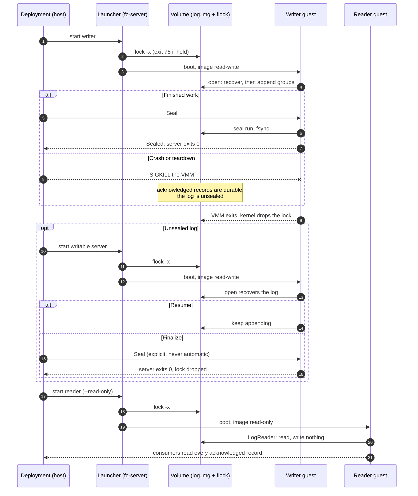

# Handoff record for the ADR 0059 stack

The [handoff record](../../architecture/testing.md#surviving-volume-handoff-before-m6) that [ADR 0033](../../decisions/0033-deployment-owns-volumes-and-reader-handoff.md) asks for, on the stack that [ADR 0059](../../decisions/0059-m7-qualifies-firecracker-on-a-dedicated-nvme-host.md) chose: one Firecracker VMM per log volume on a dedicated local-NVMe host, with the caller on the host over hybrid vsock. `scripts/m7/fc-server` is the launcher the record describes. The storage qualification is separate ([ADR 0032](../../decisions/0032-qualify-deployment-storage-before-m6.md), [issue 112](https://github.com/ironflowhq/segment-log/issues/112)).

## The surviving volume

| | |
| --- | --- |
| Volume | A raw image file, `<volume dir>/log.img`, on the host's ext4 on local NVMe. One image holds one log. |
| Created by | The launcher, on the first start: a sparse file of the planned size (`M7_LOG_BYTES`), formatted ext4. |
| Lifetime | The image is a host file. Destroying the guest or the VMM, by any path, leaves it. Only the deployment deletes it, when it archives or expires the whole log ([ADR 0037](../../decisions/0037-retain-complete-logs-through-current-milestones.md)). |
| Fencing (V5) | The launcher takes an exclusive `flock` on the image and passes the descriptor to the VMM through `exec`, so the lock lives exactly as long as the VMM process, also while it is paused. A second launcher on the same image exits 75 without booting anything. The kernel drops the lock when the VMM exits, cleanly or not. |
| Drift (V10) | Before boot the launcher checks the VMM half of `scripts/m7/fingerprint`. The guest checks its half before the log opens. |

## Guest size

The launcher sizes the guest with `M7_VCPUS` and `M7_MEM_MIB`, 2 vCPUs and 256 MiB by default. The server runs two threads per connection ([ADR 0058](../../decisions/0058-one-server-process-serves-one-log.md)), and a guest kernel's `threads-max` grows with its memory. So the memory follows `--max-connections`: 256 MiB serves the default of 64, and 1,000 connections need about 1 GiB. A 256 MiB guest refuses part of a burst of 1,000, measured by `TRANSPORT-THREAD-EXHAUSTION`.

A connection the guest has no thread for is closed at accept, with a line on the server's stderr, and the server goes on serving the others. File descriptors need no sizing: the server raises its own limit to cover `--max-connections`, and the launcher raises the VMM's before `exec`, because the VMM holds one host descriptor per vsock connection.

## Mount paths

| Role | Host side | Guest drive | Guest mount | Log directory | Process |
| --- | --- | --- | --- | --- | --- |
| Writer | `log.img`, attached read-write, `cache_type: Writeback` | `/dev/vdb` | `/mnt`, `rw,relatime,errors=remount-ro` | `/mnt/log` | `segment-log-server --dir /mnt/log --vsock-port <port>` |
| Reader | the same `log.img`, attached read-only | `/dev/vdb` | `/mnt`, `ro` with the same options | `/mnt/log` | `segment-log-server --dir /mnt/log --vsock-port <port> --read-only` |

The caller on the host dials `<volume dir>/v.sock` and the port, through Firecracker's hybrid vsock (`CONNECT <port>`). The reader component is `segment-log-server --read-only` ([ADR 0060](../../decisions/0060-the-server-reads-a-sealed-log-with-read-only.md)): it opens the log with `LogReader`, writes nothing, and answers appends with `Sealed`. Its drive is read-only too, so a bug cannot write the volume either.

## Procedure

One kernel has the volume at a time. Each step below starts only after the VMM of the step before has exited, which the `flock` enforces: a launcher for a volume whose VMM still runs exits 75.

1. **Write.** The deployment starts the writer: `fc-server --dir <volume dir>/log --vsock-port <port>`. The caller appends over vsock.
2. **The guest ends.** Either path leaves the volume and releases the lock:
   - *Finished work.* The caller sends `Seal`. The server makes the seal run durable, answers, and exits 0. The guest unmounts the volume and reboots, so the VMM exits.
   - *Crash or teardown.* The VMM dies, or the deployment kills it (`SIGKILL`, the platform's teardown path). Acknowledged records are durable on the volume (V1); the log is unsealed.
3. **A sealed log.** The deployment starts the reader on the same volume: `fc-server --dir <volume dir>/log --vsock-port <port> --read-only`. Consumers read over vsock. A log without a seal makes the reader exit 1 with `NotSealed`, and the deployment goes to step 4.
4. **An unsealed log.** The deployment starts a writable server on the same volume, as in step 1. Its open recovers the log ([overview.md](../../architecture/overview.md#open-and-recovery)). The deployment's policy then decides:
   - *Resume.* The writer keeps appending. No seal is implied.
   - *Finalize.* The deployment sends `Seal` explicitly, waits for the server to exit 0, then goes to step 3.

   The core never seals on its own ([ADR 0033](../../decisions/0033-deployment-owns-volumes-and-reader-handoff.md)): finalizing is a deployment decision, made with an explicit `Seal`.

## Sequence

The lock on the image is what passes from writer to reader: a launcher takes it before it boots anything, and the kernel releases it only when that VMM process exits.

## Evidence

`HANDOFF` is `TestHandoffSealed` and `TestHandoffUnsealed` in `clients/go/handoff_test.go`. Over `SEGMENT_LOG_TRANSPORT=firecracker` each server start is a new guest on the same image, so the writer's guest is gone before the reader's boots, and the unsealed case follows step 4 with the finalize policy. `TestReadOnlyRefusesAnUnsealedLog` checks the reader's `NotSealed` exit.

| Where | Result |
| --- | --- |
| Lima on the Mac, nested KVM (rehearsal) | Both cases pass with each change to the guest since ADR 0060, most recently with the drift checks and `errors=remount-ro` |
| Dedicated host, i7-7700 and Samsung PM981, 2026-11-16 | Both cases pass ([record](dedicated-host/README.md)) |
| Qualified host (issue 112) | To be run in the stage 2 session, with the rest of the qualification |

The step 1 fence is tested by `scripts/m7-rehearse.sh` on one host: a second launcher is refused while the owner runs and while it is paused, and one attaches after the owner is killed (`VOL-EXCLUSIVE` steps 2 and 4). Two launchers started at once on one unattached volume leave exactly one attached, in 20 of 20 rounds in Lima (step 3).

## Limits

- One host. The image never moves between hosts, so host loss is outside the failure domain unless the deployment declares otherwise ([PRD open item 12](../../prd.md#open-items)).
- `VOL-EXCLUSIVE` step 3 races two launchers on one host. Two hosts never share a volume on this stack, because the image is a file on one host's local drive.
- The deployment never copies a log volume, so V8 does not apply (provisional, issue 112).
